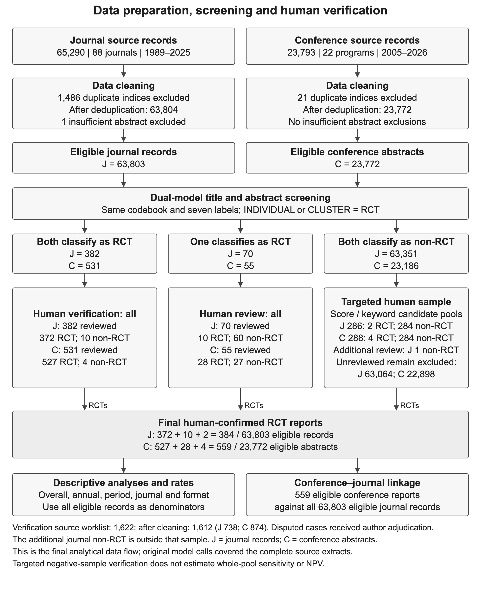

# Data preparation, screening and human-verification workflow

This is an abstract-based scientometric study of two defined document collections. The diagram follows the construction of the final analytical datasets. It does not introduce a full-text eligibility stage or treat multiple reports of a trial as a single trial. Journal and conference collections retain separate denominators throughout.

**Supplementary Figure S1. Data preparation, screening and human-verification workflow.** J denotes journal records and C conference abstracts. Eligibility criteria and category labels were shared by model screening and human review. The model-result groups shown are those of the retained, cleaned records. Classifications were retained from the complete source extracts and joined to the eligible records; the diagram describes the final analytical data flow rather than the chronology of individual model calls. The designed verification sample contains 1,612 classifiable, deduplicated records. An additional journal record classified SECONDARY is documented outside this sample and does not enter its performance denominators. Targeted negative samples do not estimate sensitivity or NPV for the complete negative pool. Final RCT counts include observed, human-confirmed reports without sampling-weighted expansion. The same reference classifications support screening-performance evaluation (Table 3).

## 1. Define the study scope and coding criteria

Retain the four manuscript research questions, the 88-journal frame, the conference-program frame, Brian's five RCT inclusion criteria and seven category labels. INDIVIDUAL and CLUSTER are the two eligible RCT classes. The same substantive [codebook](CODEBOOK.md) applies to model outputs and final human decisions.

## 2. Assemble and preserve source records

The journal screening extract contains 65,290 records from 1989–2025; the conference extract contains 23,793 abstracts from 2005–2026. Preserve source IDs and file fingerprints. These are the study screening extracts, not a count of every item in every upstream database release. [Sources and coverage](DATA_SOURCES.md) describe this distinction.

## 3. Construct the clean analysis denominators

Consolidate corroborated duplicate indices, retain unsupported duplicate candidates or distinct publication occurrences, and exclude the single insufficient journal abstract. Preserve the mapping of every source ID to an analysis ID and its exclusion reason. Standardize verified bibliographic fields for annual and venue summaries.

|Stage|Journal records|Conference abstracts|
|---|---:|---:|
|Source records|65,290|23,793|
|Duplicate indices excluded|1,486|21|
|After deduplication|63,804|23,772|
|Insufficient abstract excluded|1|0|
|Clean analysis denominator|63,803|23,772|

Duplicate removal changes denominators. Classification as OTHER, SECONDARY, QUASI, PROTOCOL or REVIEW does not remove a publication from the all-record analysis denominator. See [cleaning decisions](DATA_QUALITY_STATUS.md).

## 4. Join the two model classifications and form screening groups

Each model classified source titles and abstracts separately. Join the retained classifications to the clean records using the documented ID mapping. Both models calling INDIVIDUAL or CLUSTER defines concordant positivity, including disagreement only about randomization level. Exactly one RCT call defines a trial/non-trial disagreement. Neither model making an RCT call defines concordant negativity. Separate model runs do not imply statistically independent errors.

|Clean screening group|Journal records|Conference abstracts|Human-review route|
|---|---:|---:|---|
|Both models call RCT|382|531|Verify all|
|Only one model calls RCT|70|55|Review all; author adjudication where required|
|Both models call non-RCT|63,351|23,186|Targeted samples from two candidate pools|
|Total|63,803|23,772|Separate analysis denominators|

## 5. Verify, adjudicate and establish final reference labels

Human coding is organized by collection; disputed cases receive author adjudication. It is not represented as independent double-human coding of every record. Within concordant negatives, candidate pools are defined by either model's trial-label score of at least 0.02 and by allocation-related keywords. The pools overlap; a record selected through both is reviewed once. [Sampling documentation](NEGATIVE_AUDIT.md) distinguishes the original sampled IDs from cleaned analytical records.

|Screening group|Journal: RCT / reviewed|Conference: RCT / reviewed|
|---|---:|---:|
|Concordant positive|372 / 382|527 / 531|
|Trial/non-trial disagreement|10 / 70|28 / 55|
|Concordant-negative designed sample|2 / 286|4 / 288|
|Designed verification sample total|384 / 738|559 / 874|

The original worklist comprises 1,622 source IDs (748 journal; 874 conference). Applying the final cleaning rules excludes nine journal duplicate source IDs and one insufficient abstract, leaving 1,612 worklist records (738; 874). One additional author-reviewed journal record, 37634, is SECONDARY. It is excluded from RCT inclusion and kept outside designed-sample PPV/NPV denominators.

Unreviewed concordant negatives remain excluded: 63,064 journal records and 22,898 conference abstracts. These are model-based exclusions, not human-confirmed non-RCT labels.

## 6. Establish the final analytical outputs

Use all eligible records for rate denominators and the final human-confirmed RCT subset for numerators:

- Journal: 372 + 10 + 2 = **384 RCT reports / 63,803 eligible records**.
- Conference: 527 + 28 + 4 = **559 RCT reports / 23,772 eligible abstracts**.

The reference decisions also support a separate performance analysis: concordant-positive PPV, RCT yield among disagreements and descriptive NPV in the targeted negative sample. Performance evaluation assesses the screening process; it is not an additional step that selects more records. No whole-pool sensitivity is inferred from the targeted sample.

## 7. Analyze distributions and link the two collections

Calculate overall, annual, period, journal and conference-format counts and rates using the clean denominators. For linkage, compare all 559 eligible conference reports with the complete 63,803-record eligible journal corpus, rather than restricting the journal search to its 384 RCT reports. Keep SAME, RELATED_ONLY, INDETERMINATE and NOT_IDENTIFIED outcomes separate. The existing Figure 3 reports these linkage outcomes; Figure S1 reports preparation and screening.

## 8. Verify and freeze

Check source-to-analysis mappings, mutually exclusive model groups, final reference labels, subgroup sums, numerators, denominators and linkage aggregation. Preserve the frozen data and file hashes. [The count register](COUNT_FLOW.md) contains the full reconciliation. The current figure and documentation use the unchanged `screening-human-adjudication-final-2026-11-13-v6` analytical freeze.

## Reporting basis

These sources inform the presentation; their entire checklists are not claimed as certification of this scientometric study:

- **Montazeri et al. (2023), BIBLIO**, items 9–10 and 13: document eligibility, data refinement and selection flow. This is a preliminary bibliometric-reporting guideline developed for biomedical literature; the transparency principles are applicable here. [Systematic Reviews](https://doi.org/10.1186/s13643-023-02410-2).
- **Marzi et al. (2025), bibliometric–systematic review guidance**, step 5: use a diagram showing records retrieved, screened, excluded and included; retain source and cleaned datasets. Its synthesis/theory-development steps are not imposed on this study. [International Journal of Management Reviews](https://doi.org/10.1111/ijmr.12381).
- **Page et al. (2021), PRISMA 2020 explanation**, items 8 and 16a: describe selection methods and automation, with counts that distinguish human and automated decisions. The systematic-review template is adapted to this study's actual abstract-based design. [BMJ](https://www.bmj.com/content/372/bmj.n160).
- **Holst et al. (2025), PRISMA-trAIce**, offers a proposed AI-reporting checklist and adapted diagram distinguishing human and AI decisions. It is a methodological proposal, not a formally endorsed requirement for this study. [JMIR AI](https://ai.jmir.org/2025/1/e80247/).
- **Qin et al. (2025)** provide a related RCT-identification example with separate model-framework and human/ML screening-workflow figures. Its model training, independent external validation and double-human coding are different from this study and are not attributed to this dataset. [Research Synthesis Methods](https://doi.org/10.1017/rsm.2025.3).
